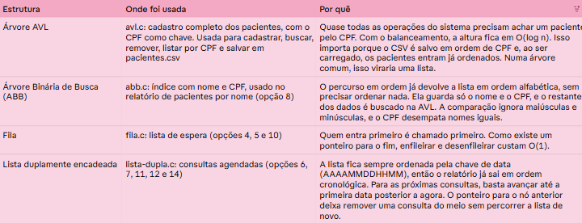

# Controle de Consultas Clinica Escola
\\ projeto desenvolvido na disciplina de programação 2 com o intuito de integrar os conteúdos vistos ao longo do semestre com uma aplicação prática real, com uma instituição existente ou ficticia. 
----------
#### CONTEXTO:
A instituição escolhida foi a Universidade Estadual de Santa Catarina (UDESC), o campus CEFID. A Udesc oferta curso de graduação em fisioterapia, a qual sendo uma área da saúde, tem a necessidade da realização de residência clínica do estudantes. Dentro do campus, se encontra uma clinica escola, onde os alunos, bolsistas e docentes responsáveis atuam atendendo a comunidade em geral que precisa de algum tipo de reabilitação. Atualmente o registro de atendimentos é feito em alguns sistemas distintos, o que acaba causando confusões em atendimentos. 

Desta forma, em uma conversa com a coordenação da clinica (prof. Luciana Sayuri), foi possível encontrar alguns gargalos e melhorias a serem feitas.
Esse sistema tem o intuito de acrescentar para ambas as instituições de ensino (IFSC e UDESC), e para a sociedade. O projeto vai crescer gradualmente.

#### FUNCIONALIDADES:
O sistema permite: cadastro, busca e remoção de pacientes; adicionar um nome na lista de espera; chamar um paciente da lista de espera; agendar; editar e cancelar uma consulta; listagem de pacientes por nome e cpf; acesso a consultas anteriores e próximos agendamentos

#### ESTRUTURAS DE DADOS UTILIZADAS:

#### COMO RODAR O SISTEMA
>cd Projeto_final_prog2
>gcc src/*.c -Iinclude -Wall -o clinica.exe
 >.\clinica.exe   

#### ARQUITETURA E ORGANIZAÇÃO:
.
├── dados/
│   ├── consultas.csv        # consultas agendadas
│   ├── lista-espera.csv     # fila de espera
│   └── pacientes.csv        # cadastro de pacientes
├── include/
│   ├── abb.h                # árvore binária de busca (índice por nome)
│   ├── avl.h                # árvore AVL (pacientes por CPF)
│   ├── fila.h               # fila da lista de espera
│   ├── lista-dupla.h        # lista duplamente encadeada de consultas
│   ├── main.h
│   ├── modelos.h            # structs Paciente e Consulta
│   ├── persistencia.h       # leitura e gravação dos CSVs
│   └── relatorios.h         # relatórios exibidos no menu
├── src/
│   ├── abb.c
│   ├── avl.c
│   ├── fila.c
│   ├── lista-dupla.c
│   ├── main.c               # menu e fluxo principal
│   ├── persistencia.c
│   └── relatorios.c
├── clinica.exe
├── image.png
└── README.md

#### DIFICULDADES E DECLARAÇÃO DE USO DE IA:
As principais dificuldades se voltam para o curto prazo de entrega e dificuldade de conciliar o horário da reunião com a clinica, o que atrasou uma semana do desenvolvimento do projeto, diminuindo o tempo ainda mais. Além desse desafio, é de se imaginar que algumas funcionalidades específicas (como fazer o meu para execução) tiveram que ser aprendidas por fora. Com isso, muitas vezes falta de material específico avaba levando ao uso da IA, que, neste projeto foi utilizada para auxílio no gerenciamento de tempo, tiração de dúvidas eventuais principalmente em dificuldades que teriam se prolongado mais que o esperado; e, por fim, foi utilizada IA para gerar elementos visuais deste Read.me 

#### AUTORIA
Beatriz Djordjevic Carneiro, 202610403403.